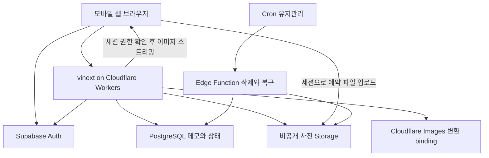
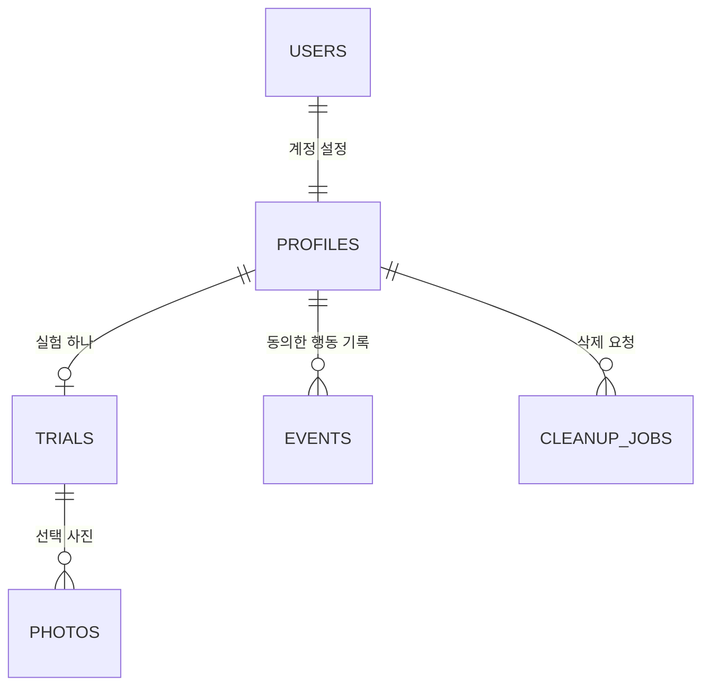
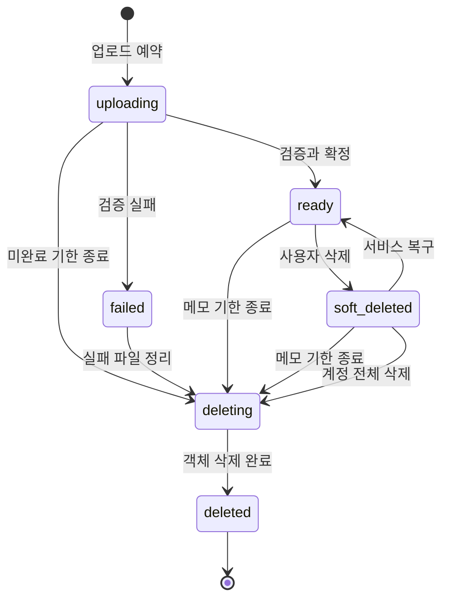

# 기억할 권리 웹앱 아키텍처 설계

이 문서는 `PROJECT.md`의 MVP를 실제 웹앱으로 구현하기 위한 기본 설계다. 사진 파일과 메타데이터를 분리하고, 두 단계 메모와 보관 상태는 하나의 DB 행에 묶어 저장한다. 실험 기간과 사진별 메모 보존 기한을 분리하는 것이 핵심이다.

웹 런타임은 Cloudflare Workers + vinext로 정했다. `recall-memory` Worker는 2026년 10월 11일 [workers.dev](https://recall-memory.jwjoo0512.workers.dev)에 배포했고 Supabase 런타임 secret을 연결했다. `/`·`/login`은 200, 비로그인 `/api/me`는 `401 UNAUTHENTICATED`다. 운영 DB는 개발과 공유하는 기존 Supabase 프로젝트다. GitHub Actions 배포 workflow는 추가했지만 `CLOUDFLARE_API_TOKEN` secret이 없어 실제 배포 단계는 아직 실행되지 않았다. Google OAuth 실제 Worker 로그인도 미검증이며 상세 상태는 `README.md`와 `ROADMAP.md`를 참고한다.

## 1. 구성과 책임



| 구성요소 | 책임 |
| --- | --- |
| 브라우저 | 사용자가 파일 선택, 사진 보기, 메모 작성, 원본·메모 ZIP 생성 |
| Cloudflare Workers + vinext | 화면 렌더링, 검증된 로그인, 요청 검증, 소유권 확인, API 제공 |
| Auth | Google OAuth와 세션 발급·갱신 |
| PostgreSQL | 사용자, 실험 시각, 파일 상태, 메모·보관 상태, 제한·삭제 작업 |
| Storage | 원본과 서버가 만든 썸네일을 비공개로 저장 |
| 유지관리 함수 | 사용자가 요청한 삭제 재시도, 24시간 지난 미완료 업로드 정리 |

실험 종료는 `now() >= ends_at`으로 판단한다. 만료를 위해 스케줄러가 제시간에 실행될 필요가 없다. 유지관리 함수는 실험 만료에 따른 정상 사진 삭제를 하지 않는다.

## 2. 기술과 배포 경계

웹앱은 vinext의 Next.js 호환 App Router와 Cloudflare Workers를 사용하며 DB·Auth·파일은 Supabase에 둔다. 업로드 검증 API는 Cloudflare Images binding으로 형식·크기·픽셀 수를 확인하고 썸네일을 WebP로 변환한다. 원본·썸네일은 계속 Supabase Storage에만 저장한다. 이미지는 변환 과정에서 Cloudflare 서비스에 전달되며 Images 변환량 제한과 데이터 처리 정책을 참여자 사진을 받기 전에 검토한다.

파일은 브라우저에서 사용자 세션으로 Storage에 직접 올려 웹앱 호스팅의 요청 본문 제한을 피한다. Storage RLS는 활성 사용자 소유의 미완료 예약 객체에만 업로드를 허용한다. 업로드 확정 API는 파일 자체가 아니라 업로드 ID를 받는다. 서버가 Storage의 파일을 읽어 검증한 후 `ready`로 확정한다.

사진 조회와 내보내기는 같은 출처의 인증 API를 통해 본인 파일을 스트리밍한다. 브라우저는 원본을 받아 ZIP을 만들며 서버가 ZIP을 HTTP 응답 본문으로 반환하지 않는다. 첫 MVP는 파일당 10 MiB와 개별 내보내기로 메모리 사용을 제한한다.

SSR 세션은 `@supabase/ssr` 공식 가이드를 따른다. 사용자별 서버 클라이언트는 요청마다 만들며 요청 간 공유하지 않는다. 인증 쿠키 갱신은 `src/proxy.ts`에서 수행한다.

Workers 호환성 날짜는 2026-10-10이며 `nodejs_compat`가 적용된다. 런타임 secret과 Supabase의 Worker callback 허용은 설정했으며, 실제 OAuth 로그인·관리 로그 접근·Images quota와 가격은 운영 전 확인한다. 무료 요금제로 모든 보존 약속을 충족한다고 가정하지 않는다.

## 3. 저장소 구조

| 경로 | 역할 |
| --- | --- |
| `AGENTS.md`, `PROJECT.md`, `ARCHITECTURE.md`, `ROADMAP.md` | 개발 지침·제품·설계·작업 기준 |
| `.env.example`, `package.json`, `package-lock.json` | 환경 이름·실행 명령·의존성 고정 |
| `src/app/page.tsx` | 소개 화면 |
| `src/app/login/page.tsx`, `src/app/auth/confirm/route.ts` | 로그인과 Auth 콜백 |
| `src/app/start/page.tsx`, `src/app/revisit/page.tsx` | 시작·다시 보기 |
| `src/app/photos/[id]/page.tsx`, `src/app/memories/page.tsx` | 상세·보관함 |
| `src/app/settings/page.tsx`, `src/app/api/` | 설정·API 진입점 |
| `src/features/upload/`, `revisit/`, `memories/`, `trial/`, `export/` | 사용자 기능별 구현 |
| `src/components/` | 공통 UI |
| `src/lib/supabase/client.ts`, `server.ts` | 브라우저·요청별 서버 클라이언트 |
| `src/lib/server/`, `validation/`, `config.ts` | 서버 전용 작업·입력 검증·정책 설정 |
| `src/types/database.ts` | 스키마에서 생성한 DB 타입 |
| `supabase/migrations/`, `supabase/functions/maintenance/` | DB 변경·정리 작업 |
| `supabase/tests/`, `tests/unit/`, `tests/integration/`, `tests/e2e/` | DB 정책·도메인·연결·화면 검증 |

초기 소스에서 보호 화면은 `src/app/(private)` route group 안에 있다. 외부 경로는 동일하며 공통 layout에서 인증을 확인한다. 최초 migration은 `supabase/migrations/20261008045831_initial_schema.sql`이다. `supabase/schema.sql`은 최신 전체 스키마이며 후속 변경은 새 migration에 작성한다. `src/types/database.ts`는 실제 적용된 스키마에서 생성하여 클라이언트에 연결한다.

## 4. 데이터 모델의 방침

사진의 보관 상태와 파일 처리 상태를 분리한다. 정상 파일은 `lifecycle = ready`, 두 메모를 완료한 보관 사진은 여기에 `preserved_at IS NOT NULL` 조건을 추가한다. 두 메모와 보관 상태는 `photos` 한 행에 있어 원자적으로 변경할 수 있다.

날짜·GPS·감정 컬럼, 별도 AI 결과 테이블, 팀·공유 권한 모델은 초기 DB에 넣지 않는다. 원본 EXIF를 검색 가능한 DB 데이터로 추출하지 않는다.



`USERS`는 Supabase 관리 `auth.users`이며 직접 스키마를 변경하지 않는다. 다음은 논리 모델이다. 실제 migration에서는 자료형·CHECK·FK·GRANT·RLS를 모두 정의한다.

### 4.1 profiles

| 필드 | 자료형·제약 | 의미 |
| --- | --- | --- |
| `user_id` | UUID PK, `auth.users.id` FK | 사용자 식별자 |
| `timezone` | text, 기본 `Asia/Seoul` | 화면 시각 표시용 |
| `account_state` | `active / deleting` | 계정 삭제 중 새 접근 차단 |
| `analytics_consent` | boolean, 기본 false | 제품 행동 분석 동의 |
| `created_at` | timestamptz | 계정 생성 시각 |

계정 삭제는 파일 정리 완료 후 Auth 계정을 제거하는 순서를 따른다. 파일이 남은 상태에서 DB 연결을 CASCADE로 끊지 않도록 FK 삭제 동작을 설계한다.

### 4.2 trials

| 필드 | 자료형·제약 | 의미 |
| --- | --- | --- |
| `id` | UUID PK | 실험 ID |
| `user_id` | UUID FK, UNIQUE | MVP에서 사용자당 실험 하나 |
| `duration_hours` | integer, 기본 48, 양수 | 시작 시 적용할 기간 |
| `started_at` | timestamptz, nullable | 첫 `ready` 업로드 시 DB 시간으로 설정 |
| `ends_at` | timestamptz, nullable | `started_at + duration_hours` |
| `experiment_version` | text | 실험 정의 버전 |
| `created_at` | timestamptz | 시작 안내 진입·예약 시 생성 |

`started_at`과 `ends_at`은 둘 다 null이거나 둘 다 값이 있어야 한다. 두 값이 있으면 `ends_at > started_at`을 보장한다. 첫 업로드 확정은 실험 행을 잠그고 한 번만 시각을 정한다.

별도 `expired` 컬럼을 유지하지 않는다. `not_started / active / ended`는 DB 현재 시각으로 계산한다. 기존 실험의 시각은 기본 설정이 바뀌어도 바꾸지 않는다.

### 4.3 photos

| 필드 | 자료형·제약 | 의미 |
| --- | --- | --- |
| `id` | UUID PK | 사진 ID, 서버가 생성 |
| `user_id` | UUID FK | 소유자 |
| `trial_id` | UUID FK | 참여 실험 |
| `client_request_id` | UUID, 사용자와 복합 UNIQUE | 업로드 예약 중복 방지 |
| `lifecycle` | enum 또는 CHECK text | `uploading / ready / failed / soft_deleted / deleting / deleted` |
| `original_key` | text UNIQUE | 원본 Storage 객체 경로 |
| `thumbnail_key` | text UNIQUE, nullable | 썸네일 객체 경로 |
| `original_name` | text | 사용자가 선택한 파일명, 로그에 기록하지 않음 |
| `mime_type` | text | 서버가 확인한 MIME |
| `byte_size` | bigint | 실제 원본 바이트 수 |
| `width`, `height` | integer | 디코딩 후 실제 크기 |
| `note_text` | text, 기본 빈 문자열 | 첫 번째 메모, 최대 500자 |
| `second_note_text` | text, 기본 빈 문자열 | 두 번째 메모, 최대 500자 |
| `preserved_at` | timestamptz, nullable | 두 번째 메모 저장 시각, 이후 메모를 비워도 유지 |
| `first_note_at` | timestamptz, nullable | 첫 번째 유효 메모 저장 시각 |
| `second_note_at` | timestamptz, nullable | 두 번째 유효 메모 저장 시각 |
| `first_viewed_at` | timestamptz, nullable | 다시 보기에서 최초 조회, 순서 이어보기용 |
| `version` | integer, 기본 1 | 메모 충돌·상태 변경 확인 |
| `upload_deadline_at` | timestamptz | 예약 후 24시간, 미완료 정리 기준 |
| `validation_token`, `validation_until` | UUID·timestamptz, nullable | 서버 확정 처리의 5분 lease, 이전 작업의 늦은 확정 거절 |
| `ready_at` | timestamptz, nullable | 검증 완료 시각 |
| `delete_requested_at` | timestamptz, nullable | 소프트 삭제 또는 실제 삭제 요청 시각 |
| `deleted_at` | timestamptz, nullable | 실제 파일 정리 완료 시각 |
| `created_at`, `updated_at` | timestamptz | 생성·수정 시각 |

소유권 교차 연결을 막기 위해 `trials`에 `(id, user_id)` UNIQUE를 두고 `photos(trial_id, user_id)`가 이를 참조하는 복합 FK를 둔다. `user_id`, `trial_id`, 객체 경로는 생성 후 일반 수정 대상이 아니다.

`ready` 행은 원본·썸네일과 검증 메타데이터가 모두 있어야 한다. 첫 메모 기한은 `ready_at + 24 hours`, 두 번째 메모 기한은 `first_note_at + 48 hours`다. `preserved_at`은 두 번째 메모를 저장할 때만 설정한다. 보관 후 두 메모를 수정하거나 비워도 최초 시각과 보관 상태는 유지한다. 메모 길이는 프런트와 DB에서 같은 Unicode 코드포인트 기준으로 검증한다.

### 4.4 events

| 필드 | 자료형·제약 | 의미 |
| --- | --- | --- |
| `id` | UUID PK | 이벤트 ID |
| `user_id` | UUID FK | 로그인으로 확인한 사용자 |
| `trial_id`, `photo_id` | UUID, nullable | 본인 소유 대상만 허용 |
| `name` | 허용 목록 text | 행동 종류 |
| `occurred_at` | timestamptz | 서버 수신·도메인 처리 시각 |
| `client_event_id` | UUID, 사용자와 복합 UNIQUE | 클라이언트 재전송 중복 방지 |
| `visit_context` | `organic / prompted / unknown` | 재방문 구분, 불명확하면 unknown |

자유 형식 `payload`는 MVP에서 두지 않는다. 메모, 사진, 파일명, EXIF, 이메일, URL을 이벤트에 넣지 않는다. 동의하지 않은 사용자는 제품 기능을 동일하게 사용할 수 있다. 도메인 시각은 기능에 필요한 최소 데이터로 별도 유지한다.

허용 이벤트는 `trial_started`, `photo_viewed`, `note_saved`, `memory_opened`, `export_generated`로 제한한다. `export_generated`는 브라우저가 ZIP을 만들었다는 뜻이며 사용자의 저장장치에 저장 완료했다는 뜻이 아니다.

중요 저장 이벤트는 가능하면 DB 트랜잭션에서 생성한다. 분석 동의가 없거나 분석 기록이 실패했다는 이유로 사진·메모 저장이 실패해서는 안 된다. 필요하면 저장된 도메인 시각에서 보관 사용자 수를 동의 범위 안에 집계한다.

### 4.5 cleanup_jobs

| 필드 | 자료형·제약 | 의미 |
| --- | --- | --- |
| `id` | UUID PK | 정리 작업 |
| `user_id` | UUID FK, nullable, 계정 정리 시 SET NULL | 진행 중 대상 소유자, 완료 후 연결 제거 |
| `photo_id` | UUID, nullable | 개별 사진 정리 대상 |
| `kind` | `photo_delete / account_delete / incomplete_upload / retention_expired` | 허용 정리 이유 |
| `dedupe_key` | text UNIQUE | 중복 요청 방지 |
| `status` | `pending / running / retry / done / failed` | 작업 상태 |
| `attempts` | integer | 시도 횟수 |
| `run_after`, `locked_until` | timestamptz | 재시도 시각·작업 lease |
| `lease_token` | UUID, nullable | 현재 유지관리 실행만 완료 상태를 갱신하는 권한 |
| `created_at`, `finished_at` | timestamptz | 추적 시각 |
| `error_code` | text, nullable | 개인정보 없는 에러 코드 |
| `progress_token_hash` | text, nullable | 계정 삭제 진행 확인 토큰의 해시 |
| `progress_expires_at` | timestamptz, nullable | 진행 확인 권한의 만료 시각 |

이는 MVP 복구용 DB 작업 목록이며 범용 Queue 서비스를 추가하지 않는다. 계정 삭제는 사용자 차단 후 사진별 정리를 반복하고 마지막에 계정·개인 이벤트를 지운다. 이 테이블의 일반 사용자 직접 조회·변경은 차단한다. 완료 후에는 사용자·사진 연결과 상세 오류를 제거하고 제한된 진행 결과만 토큰 만료 때까지 남긴다.

### 4.6 인덱스

- `photos(user_id, lifecycle, ready_at, id)`: 본인 사진 목록과 다시 보기.
- `photos(user_id, preserved_at DESC, id)`의 보관 행 partial index: 보관함.
- `photos(trial_id, user_id)`: 복합 FK와 실험별 집계.
- `photos(upload_deadline_at)`의 미완료 행 partial index: 실패 업로드 정리.
- `events(user_id, occurred_at)` 및 필요 시 대상 FK 인덱스.
- `cleanup_jobs(status, run_after)`: 실행 대상 조회.

UNIQUE 제약으로 이미 생긴 인덱스는 중복 생성하지 않는다. 실제 쿼리와 RLS 소유권 조건에 맞춰 검증하고 미리 대규모 분석용 인덱스를 늘리지 않는다.

## 5. Storage 경로와 권한

버킷 이름은 `memory-assets`로 제안하며 반드시 private로 생성한다.

```text
{user_id}/{photo_id}/original.{verified_extension}
{user_id}/{photo_id}/thumbnail.webp
```

경로는 서버가 예약 시 생성한다. 원본 파일명은 객체 경로로 사용하지 않는다. 원본이 JPEG·PNG·WebP인지에 맞춰 예약하고 실제 형식이 다르면 거절한다. 기존 파일 덮어쓰기는 기본적으로 비활성화한다.

| 동작 | 주체·권한 |
| --- | --- |
| 업로드 예약 | 검증된 사용자 요청을 받은 서버 |
| 원본 PUT | 예약 객체에 대한 사용자 세션과 Storage RLS |
| 썸네일 생성·파일 삭제 | 서버 또는 유지관리 함수의 비밀 키 |
| 정상 사진 SELECT·다운로드 | 본인 세션, `ready` 행·활성 계정만; `soft_deleted` 행과 객체는 사용자 접근 차단 |
| DB 직접 변경·직접 삭제 | 일반 브라우저 사용자에게 허용하지 않음 |

Storage SELECT 정책은 `photos`의 소유자, 객체 키, `ready` 상태와 활성 계정을 확인한다. 소프트 삭제된 행과 객체는 일반 사용자 RLS 및 API에서 숨기며 서버 권한으로만 복구할 수 있다. 업로드 중인 파일도 노출하지 않는다.

메모 조회는 DB RLS로 본인 행만 허용한다. 인증 사용자에게 테이블 직접 UPDATE 권한을 주지 않아 `ends_at`·소유자·보관 상태 조작을 막는다. 공개 테이블의 SELECT 권한, RLS 정책, 관련 함수 EXECUTE 권한을 명시적으로 설정한다.

서버 변경 함수는 `SECURITY INVOKER`로 만들고 EXECUTE를 PUBLIC·anon·authenticated에서 회수한 뒤 서버 역할에만 허용한다. 서버 역할은 RLS를 우회하므로 함수가 전달받은 검증된 사용자 ID로 소유권을 다시 검사해야 한다. 임의 `user_id`를 요청 본문에서 받지 않는다.

브라우저에는 Storage 서명 URL이나 업로드 token을 반환하지 않는다. 조회는 사용자 세션으로 사진 소유권·라이프사이클을 확인한 뒤 Storage에서 읽어 같은 출처의 `private, no-store` API 응답으로 돌려준다. 예약 업로드는 비공개 버킷의 INSERT RLS가 활성 계정·소유자·예약 키·업로드 기한·실험 기간을 확인한다. 사용자 사진 삭제는 일반 DB·Storage 조회를 막되 행과 객체는 남긴다. 계정 삭제와 미완료 업로드 정리는 유지관리 작업이 실제 객체를 제거한다.

## 6. 상태와 기간 규칙



보관은 별도 라이프사이클 전이가 아니다. `ready` 상태에서 두 메모를 모두 저장하면 `preserved_at`이 생긴다. 메모 기한을 넘긴 사진은 `deleting`으로 바뀌고 기존 Storage 삭제 큐가 처리한다.

| 조건 | 허용 동작 |
| --- | --- |
| 실험 미시작 | 업로드 예약·첫 확정, 아직 기간 없음 |
| 실험 진행 중 | 새 업로드, 사진 조회, 메모, 보관함, 내보내기, 휴지통 이동·복구 |
| 실험 종료 | 두 메모가 완료된 사진 조회·수정·내보내기, 사용자 삭제 |
| 사진 소프트 삭제 | `soft_deleted`로 전환, 사용자 화면·API·RLS에서 숨김; 서비스 역할의 복구 RPC로만 되돌릴 수 있음 |
| 계정 deleting | 사용자 데이터 API 차단, 삭제 진행 상태 조회만 허용 |

업로드 예약과 확정 모두 서버·DB 시간을 확인한다. 만료 전에 예약해도 만료 후 확정한 신규 사진은 `ready`로 만들지 않고 정리한다. 첫 정상 확정은 아직 시작하지 않은 실험을 시작한다.

첫 메모는 업로드 확정 후 24시간 안에 저장해야 한다. 첫 메모 뒤 48시간 안에 두 번째 메모를 저장해야 `preserved_at`이 설정된다. 메모 기한이 지난 경우 DB 함수가 삭제를 예약하고 저장을 거절한다. 유지관리 함수는 10분마다 기한이 지난 `ready`·`soft_deleted` 사진을 삭제 큐에 넣는다. 실험 종료 후에도 해당 메모 기한 안이면 저장할 수 있다. 브라우저 시계는 화면 표시용이며 정책 판단에 쓰지 않는다.

## 7. 업로드 처리

1. 브라우저에서 지원 형식과 표시 크기를 먼저 검사한다. `accept`는 사용성 힌트다.
2. `POST /api/uploads`가 계정 상태, 실험 상태, 슬롯·크기를 검증한다.
3. DB 함수가 사용자 실험 행을 잠그고 계정의 비삭제 사진·예약이 20장 이내인지 확인한다. 한 번의 선택은 최대 10장이다.
4. `photos`에 `uploading` 예약을 만들고 고정된 원본 객체 키를 반환한다. Storage INSERT RLS가 예약된 소유자 path인지 확인한다.
5. 브라우저가 원본을 Storage에 업로드한다. 파일별 실패·재시도 상태를 보여 준다.
6. `POST /api/uploads/[id]/complete`가 실제 객체를 읽어 크기·형식·정상 디코딩을 검사한다. 최대 원본 10 MiB, 최대 4천만 픽셀을 기본으로 한다.
7. 서버가 방향을 바로잡은 긴 변 1280px 이하 WebP 썸네일을 만들고 EXIF를 제거한다. 원본 바이트는 변경하지 않는다.
8. DB 트랜잭션에서 계정·기한·사진 상태를 다시 확인하고 `ready`와 메타데이터를 확정한다. 최초 정상 파일이면 실험 시작·종료 시각도 함께 설정한다.
9. 검증 실패나 확정 거절은 정상 사진으로 노출하지 않고 정리 작업을 등록한다.

Storage와 DB는 하나의 분산 트랜잭션이 아니다. 예약 행 → 파일 전송 → 검증 → DB 확정 순서와 보상 정리로 일관성을 맞춘다. 썸네일 생성까지만 성공한 상태도 재확정 또는 정리할 수 있어야 한다.

`client_request_id` 재요청은 기존 예약을 돌려준다. 정상 확정된 ID의 complete 재요청은 같은 사진을 반환한다. 검증 중 중복 호출은 lease 또는 상태 잠금으로 하나의 확정만 허용한다. 자동 정리가 먼저 deleting 상태를 잡았다면 확정은 거절한다.

크기·형식 제한은 클라이언트, 예약 API, 버킷 제한, 확정 검사에서 맞춘다. 미완료 파일은 데이터가 보관된 사진이 아니며 24시간 후 정리할 수 있음을 시작 안내에 적는다. 삭제 중 파일은 삭제 완료 전까지 총 저장 한도 계산에 포함한다.

## 8. 메모와 보관 트랜잭션

`PUT /api/photos/[id]/note` 입력은 `note_stage` (`first / second`), `note_text`, `expected_version`, `request_id`다. `request_id`는 분석 중복 구분과 요청 추적용이고 실제 수정 충돌은 버전으로 확인한다.

처리는 하나의 DB 함수 안에서 다음 순서를 따른다.

1. 해당 `user_id`의 활성 계정과 `ready` 사진을 확인하고 행 잠금을 획득한다.
2. DB 현재 시각으로 메모 기한을 확인한다. 기한이 지났으면 사진 삭제를 예약하고 `PHOTO_EXPIRED`를 반환한다.
3. `note_stage`에 맞는 메모가 비어 있지 않은지 확인한다. 보관 후에는 메모 비우기를 허용한다.
4. 버전이 다르면 409 충돌을 반환한다. 네트워크 재시도로 해당 메모가 이미 요청 내용과 같다면 동일 결과를 반환할 수 있다.
5. 첫 메모는 `note_text`·`first_note_at`, 두 번째 메모는 `second_note_text`·`second_note_at`에 저장한다. 두 번째 저장 시 `preserved_at`을 설정한다.
6. 실제 내용 변경이나 최초 시각 기록에 버전을 증가시킨다. 각 최초 시각은 덮어쓰지 않는다.
7. 분석 동의가 있다면 허용 이벤트를 남긴다. 동일 저장의 재시도를 새 보관으로 세지 않는다.
8. 커밋 후 두 메모·기한 시각·보관 시각·버전을 반환한다.

메모를 보관하고 나서 원본을 다른 버킷으로 이동하지 않는다. 선택 여부는 DB 값으로 표현하여 파일 이동 실패가 보관 실패로 이어지지 않게 한다.

## 9. API 계약

모든 사용자 API는 서버에서 검증된 로그인과 활성 계정을 요구한다. 현재 구현은 `getUser()`로 사용자와 활성 프로필을 확인하며, 업로드 확정·계정 삭제의 내부 RPC는 같은 요청에서 검증한 결과를 재사용한다. 요청 간 인증 결과를 공유하지 않으며 DB 함수의 소유권·계정 상태·라이프사이클 검사도 유지한다. 예외는 로그인·Auth 콜백과 제한된 삭제 진행 토큰 조회다. JSON 스키마 검증을 공유하고 사용자 ID는 서버가 결정한다.

| 메서드·경로 | 입력·동작 | 정상 응답 |
| --- | --- | --- |
| `GET /api/me` | 계정·실험 조회 | 실험 시각, 서버 시각, 허용 동작 |
| `POST /api/uploads` | 파일명·MIME·크기·client_request_id 목록 | 파일별 예약 ID·객체 path, 201; 브라우저가 사용자 세션으로 SDK 직접 전송 |
| `POST /api/uploads/[id]/complete` | 예약 파일 검증·확정 | `{ photo }` 사진 상태, 200; 실험 시각은 `GET /api/me`로 조회 |
| `GET /api/photos` | cursor, limit, `all / preserved` | 본인 정상 사진 목록, 200 |
| `GET /api/photos/[id]` | 상세 조회 | 메모·버전·보관 시각, 200 |
| `POST /api/photos/[id]/view` | 실제 다시 보기 화면에 사진이 나타난 뒤 호출 | 최초 조회 시각 기록, 204 |
| `GET /api/photos/[id]/asset` | `kind=original / thumbnail` | 본인 정상 사진의 바이너리 스트림, `private, no-store`, 200 |
| `PUT /api/photos/[id]/note` | note_stage·메모·expected_version·request_id | 저장 결과, 200; 기한 초과는 `PHOTO_EXPIRED`, 409 |
| `GET /api/photos/[id]/export` | 내보내기 준비 | ZIP 파일명·두 메모를 포함한 `memory.json` v2; 원본은 asset API에서 별도 수신, 200 |
| `DELETE /api/photos/[id]` | 사진·메모를 사용자 화면에서 삭제, 복구 데이터는 유지 | `{ status: "deleted" }`, 200 |
| `POST /api/events` | 허용 이벤트·client_event_id | 동의 여부에 따라 기록 또는 무기록, 204 |
| `PATCH /api/me/preferences` | 분석 동의·타임존 | 현재 설정, 200 |
| `DELETE /api/me` | 본인 계정·데이터 삭제 | 삭제 작업 ID·진행 확인 토큰, 202 |
| `GET /api/deletions/[job_id]` | 본인 세션 또는 작업별 진행 토큰 | 진행 중·실패·완료만, 200 |

목록은 기본 12개, 최대 20개이며 안정적인 `(ready_at, id)` 또는 `(preserved_at, id)` cursor를 쓴다. 소프트 삭제된 행은 사용자 목록 API에서 반환하지 않는다. 다시 보기의 최초 조회 시각은 사용자가 실제로 사진을 본 뒤 POST로 한 번만 기록한다. GET·prefetch만으로 조회 행동을 기록하지 않는다. 분석용 반복 조회는 동의한 이벤트와 별도로 취급한다.

업로드 확정 응답은 사진 결과만 반환한다. 사진 확정 후 부가 계정 조회 실패 때문에 업로드 성공을 실패로 응답하지 않는다. 다시 보기와 보관함 목록은 재시도 전 요청의 늦은 성공·오류 응답을 무시한다.

오류 응답은 `{ "error": { "code": "...", "message": "...", "request_id": "..." } }`를 기본으로 한다.

| HTTP·코드 | 의미 |
| --- | --- |
| 400 `INVALID_INPUT` | 메모 길이, 목록 크기 등 입력 오류 |
| 401 `UNAUTHENTICATED` | 유효 로그인 없음 |
| 403 `ACCOUNT_DELETING` | 삭제 진행 중 계정 |
| 404 `NOT_FOUND` | 사진 없음·다른 사용자 사진, 존재 여부를 구분하지 않음 |
| 409 `VERSION_CONFLICT` | 저장된 버전과 다른 메모 수정 |
| 409 `TRIAL_ENDED` | 신규 업로드 기간 종료 |
| 409 `PHOTO_NOT_READY` | 미완료·삭제 중 사진에 저장 시도 |
| 409 `PHOTO_EXPIRED` | 메모 기한이 지나 사진과 메모 삭제를 시작함 |
| 413 `FILE_TOO_LARGE` | 파일 크기·픽셀 수 초과 |
| 415 `UNSUPPORTED_MEDIA` | 미지원·위장·깨진 이미지 |
| 429 `LIMIT_EXCEEDED` | 파일 수·요청 속도 제한 |
| 503 `TEMPORARY_FAILURE` | Storage·DB 일시 오류, 재시도 안내 |

### 요청과 응답 예시

```json
{
  "note_stage": "first",
  "note_text": "비 오는 날에도 같이 걸어줘서 고마웠다.",
  "expected_version": 1,
  "request_id": "<client-generated-uuid>"
}
```

```json
{
  "photo_id": "<photo-uuid>",
  "note_text": "비 오는 날에도 같이 걸어줘서 고마웠다.",
  "second_note_text": "",
  "preserved_at": null,
  "first_note_at": "2026-10-08T01:00:00Z",
  "second_note_at": null,
  "version": 2
}
```

예시의 식별자는 설명용 자리표시자이며 그대로 실행할 값이 아니다.

## 10. 내보내기와 삭제

### 10.1 개별 내보내기

서버는 본인 소유 정상 파일과 메모를 확인해 ZIP 파일명·JSON을 반환한다. 브라우저는 본인 세션의 asset API에서 원본을 가져오고 고정 버전 라이브러리로 아래 ZIP을 만든다. Storage 서명 URL·token은 브라우저나 내보내기 API에 전달하지 않는다.

| ZIP 내부 파일 | 내용 |
| --- | --- |
| `original.jpg` 또는 실제 형식의 확장자 | 사용자가 올린 원본 바이트 |
| `memory.json` | 메모와 최소 메타데이터 |

ZIP 이름은 `memory-{photo_id}.zip`으로 제안한다.

`original`의 확장자는 실제 형식에 따른다. 안전한 파일명을 쓰고 원래 파일명은 JSON 필드로 보존한다. JSON은 UTF-8이며 최소 필드는 `schema_version: 2`, `photo_id`, `original_name`, `note_text`, `second_note_text`, 두 메모 시각, `uploaded_at`, `preserved_at`, `exported_at`이다. 미보관 사진의 `preserved_at`은 null이다.

ZIP을 만들기 전에 이미지 읽기와 JSON 생성이 모두 성공해야 한다. 네트워크 실패를 표시하고 다시 요청할 수 있다. 다운로드 버튼을 눌렀다는 이유로 실제 보존 성공을 기록하지 않는다. QA는 ZIP을 직접 열고 원본 해시와 두 한글 메모를 비교한다.

### 10.2 개별 삭제

1. 확인창에서 화면에서 삭제되며 데이터는 복구를 위해 서비스에 남는다는 점을 안내한다.
2. 사용자 확인 후 DB 트랜잭션에서 `ready`를 `soft_deleted`로 바꾸고 `delete_requested_at`을 기록한다. 사진 원본·썸네일·메모·보관 정보는 그대로 둔다.
3. 사용자 화면·일반 DB/Storage RLS·상세·목록·내보내기·메모 저장 API에서 숨긴다. 삭제한 사진 목록이나 사용자 복구 화면은 제공하지 않는다.
4. 필요할 때만 서버 전용 `restore_photo` RPC로 `soft_deleted`를 `ready`로 되돌릴 수 있다. 일반 사용자의 EXECUTE 권한과 restore API는 두지 않는다.
5. 사용자 사진 삭제는 화면에서 숨기며 소프트 삭제 사진도 계정당 20장 한도에 포함한다. 두 메모 기한을 채우지 못한 소프트 삭제 사진은 기한이 지나면 자동 정리 대상이다. 두 메모가 모두 저장된 사진은 복구 또는 계정 전체 삭제까지 유지한다.

`soft_delete_photo`와 `restore_photo`는 profile과 photo 행을 같은 순서로 잠가 메모 수정·계정 삭제와 직렬화한다. 두 함수는 서버 역할만 실행할 수 있고 사용자 조회 정책은 `ready` 행과 객체만 허용한다. 브라우저에 DB·Storage 직접 쓰기 권한은 없다.

### 10.3 계정 삭제와 유지관리

계정 삭제는 `profiles.account_state = deleting`을 먼저 적용한다. 새 사용자 데이터 접근을 차단하고 세션을 종료하는 절차를 진행한다. 재시도를 담당하는 작업은 로그아웃과 무관하게 계속 처리한다.

소프트 삭제 사진을 포함한 모든 본인 파일이 삭제된 뒤 메모·사진·실험·개인 이벤트·profile과 Auth 계정을 제거한다. 파일 정리 전에는 참조 행을 먼저 제거하지 않는다. 진행 확인에는 32바이트 난수 토큰을 발급하고 서버에는 SHA-256 해시만 저장한다. 브라우저는 토큰을 현재 탭의 sessionStorage에 최대 24시간 보관하고 Authorization 헤더로 해당 작업 조회에만 사용한다. 계정이 삭제되어도 진행 중·실패·완료 상태만 확인할 수 있으며 사용자·파일·메모 정보는 반환하지 않는다. 토큰 만료는 조회 권한만 끝내며 진행 중 정리 작업을 없애지 않는다. 완료된 작업의 최소 결과는 토큰 만료 후 정리한다.

Cron은 10분마다 유지관리 함수를 호출하는 기본안이다. 호출 비밀은 서버/Vault에 저장한다. 재시도는 1분·5분·30분·2시간 이후로 지연시키고 계속 실패하면 운영 확인 대상으로 남긴다. 작업 lease 만료 시 다른 실행이 이어 처리한다.

미완료 업로드는 `uploading / failed`, 업로드 예약 기한 경과 조건으로 정리한다. 정상 파일은 첫 메모가 없고 `ready_at + 24 hours`가 지난 경우 또는 두 번째 메모가 없고 `first_note_at + 48 hours`가 지난 경우 정리한다. 이미 보관된 사진은 실험 만료와 별도로 유지한다.

## 11. 설정과 관측

| 설정 | 기본값·용도 |
| --- | --- |
| `NEXT_PUBLIC_SUPABASE_URL` | 프로젝트 URL |
| `SUPABASE_PROJECT_ID` | 앱 연결 프로젝트 ID, DB 타입 생성 대상 |
| `NEXT_PUBLIC_SUPABASE_PUBLISHABLE_KEY` | 브라우저 공개용 키 |
| `SUPABASE_SERVER_SECRET_KEY` | 서버 변경 전용 비밀 키, 배포 환경에서 SDK 호환 키 사용 |
| `APP_BASE_URL` | Auth 콜백의 허용 주소 |
| `TRIAL_DURATION_HOURS` | 48, 새 실험 생성 시 DB에 복사 |
| `FIRST_NOTE_HOURS` | 24, 업로드 확정 뒤 첫 메모 기한 |
| `SECOND_NOTE_HOURS` | 48, 첫 메모 저장 뒤 두 번째 메모 기한 |
| `MAX_PHOTOS_PER_USER` | 20, 기존·보관·미선택·휴지통·예약 합계 한도 |
| `MAX_FILES_PER_BATCH` | 10 |
| `MAX_IMAGE_BYTES` | 10485760, 10 MiB |
| `MAX_IMAGE_PIXELS` | 40000000 |
| `ASSET_URL_TTL_SECONDS` | 300 |
| `UPLOAD_RESERVATION_TTL_HOURS` | 24 |
| `MAINTENANCE_CALL_SECRET` | 내부 함수 호출 인증, 브라우저 노출 금지 |

위 제한 설정의 이름은 논리적 설정 이름이다. 이번 초기 구현은 런타임 환경변수로 제한을 조절하지 않고 `src/lib/config.ts`와 서버 전용 `public.app_policy()`에 기본값을 고정한다. `.env.example`에는 앱 프로젝트 ID·URL·키·APP_BASE_URL·유지관리 비밀·별도 통합 검증 연결 이름을 둔다. 사용자의 지시에 따라 현재 개발과 MVP 운영은 같은 Supabase 프로젝트를 사용한다. `.env.local`의 `SUPABASE_ENVIRONMENT=production`은 fixture 기반 통합/E2E 테스트를 거부한다. 검증은 앱 DB와 분리한 Supabase 프로젝트에서만 실행한다. 통합 검증에서 두 정책이 같은지 확인하며 값 변경 시 새 migration과 TypeScript 설정을 함께 수정한다. 제한값을 요청 본문으로 받아 DB에 전달하지 않는다. Auth 콜백은 허용 주소로만 이동한다.

앱이 직접 관리하는 로그에는 request ID, 고정 API 경로, HTTP method·상태, 처리 시간, 오류 코드, 처리 단계, 허용된 오류 종류와 DB/Images provider 코드만 남긴다. API 공통 `endpoint()`가 한 줄 JSON을 출력하며 실제 사진 ID·요청 URL·본문·사용자 ID·메모·파일명·쿠키·서명 URL·OTP·token·원문 오류·stack·details는 기록하지 않는다. 실패 응답의 `error.request_id`와 `X-Request-Id`는 로그와 같은 ID를 사용하며 업로드 화면에도 표시한다. 개발 브라우저에는 업로드 단계·임의 요청 ID·Storage HTTP 상태만 기록한다. Worker 설정에는 custom logs 수집, invocation logs·traces 비활성화, query string 제거를 추가했으며 아직 배포 전이다. 호스팅·Auth·Storage 제공자의 managed logs는 별도 보존·접근 정책을 검토한다. 2026년 10월 공유 Supabase 프로젝트의 managed log에는 계정 식별자·IP·요청 경로 메타데이터가 포함된다. 분석 이벤트는 동의 설정과 연동하며 개인 사진을 운영자가 열어 보는 관리 화면은 MVP에 만들지 않는다.

2026-10-11 Supabase unified logs 최근 24시간을 source·건수·시각으로만 집계해 Auth, Edge/Function, Postgres/PgBouncer, Storage 로그가 수집됨을 확인했다. Free 요금제의 관리 로그 접근 범위는 최근 1일이다. 이 집계는 보존 기간 전체나 실제 접근 권한 목록을 확인한 것은 아니다. Supabase 구성원 역할과 Cloudflare 호스팅 로그 설정은 별도 검토가 필요하다.

MVP 출시 전에 파일 저장량·전송량·삭제 작업 실패 수를 확인할 수 있게 한다. 계정당 원본은 최대 약 200 MiB이며 썸네일·전송량·유예 중 파일은 추가 비용이다. 비용 때문에 정상 보관 사진을 몰래 삭제하지 않는다.

DB 백업과 객체 파일 백업은 별개다. 보관 약속을 운영하는 동안의 복구 계획, 실제 파일 복원 여부, 서비스 종료 시 반출 방침을 점검한다. 공급자의 DB 백업이 사진 파일도 복원해 준다고 가정하지 않는다.

## 12. 주요 실패와 검증

| 실패 | 처리·검증 |
| --- | --- |
| 업로드 중 연결 종료 | 같은 예약 재시도 또는 24시간 후 미완료 정리 |
| 파일 완료 후 DB 확정 실패 | complete 재시도, 검증 전 정상 목록에 미노출 |
| Storage 성공·썸네일 실패 | 재생성 후 확정, 실패 사진 자동 보관 없음 |
| 메모 저장 응답 유실 | 현재 내용·버전 재조회, 동일 저장 중복 보관 방지 |
| 두 기기 동시 수정 | 409, 두 내용을 보여 주고 사용자가 선택 |
| 만료 직전 업로드 | 확정 시 DB 시간으로 재확인 |
| 메모 기한 초과 | 저장을 거절하고 사진·메모를 삭제 대기열에 넣음 |
| 실험 종료 후 메모 | 해당 사진의 메모 기한 안이면 저장 허용 |
| URL 만료 | 새 접근 권한 확인 후 재발급 |
| 사용자 A의 ID를 B가 요청 | 404 또는 권한 차단, DB·Storage에서도 거절 |
| 삭제 작업 실패 | 조회 차단 유지, 재시도·운영 확인 |
| 브라우저 재접속 | DB 상태에서 복원, 보관 상태가 브라우저 저장소에 의존하지 않음 |

개발 검증은 단위 테스트, 격리된 Auth·DB·Storage 통합 테스트, 모바일 E2E로 나눈다. 특히 서버 비밀 키가 있는 API의 소유권 검사와 브라우저의 직접 변경 우회 시도를 실제 연결에서 검사한다.

## 13. 공식 기술 참고

2026년 10월 8일 설계 시 확인한 공식 자료다. 아래 기술 동작을 참고한 설계이며 제품 효과를 입증하는 자료는 아니다. 구현 시 다시 버전·권한·가격을 확인한다.

- [Next.js Route Handlers](https://nextjs.org/docs/app/getting-started/route-handlers): 화면과 API를 한 웹앱에서 구성.
- [Supabase SSR 클라이언트](https://supabase.com/docs/guides/auth/server-side/creating-a-client?queryGroups=framework&framework=nextjs): 쿠키 세션·클라이언트 분리·검증·캐시 주의.
- [Supabase Storage 버킷](https://supabase.com/docs/guides/storage/buckets/fundamentals): 비공개 버킷과 제한된 접근.
- [Storage 접근 제어](https://supabase.com/docs/guides/storage/security/access-control): Storage RLS.
- [Storage 파일 제공](https://supabase.com/docs/guides/storage/serving/downloads): 비공개 파일 인증 다운로드.
- [Supabase Row Level Security](https://supabase.com/docs/guides/database/postgres/row-level-security): 소유권 정책과 인덱스.
- [Supabase 새 테이블 API 노출 변경](https://supabase.com/changelog/45329-breaking-change-tables-not-exposed-to-data-and-graphql-api-automatically): 새 테이블의 명시적 GRANT 확인.
- [Supabase Changelog](https://supabase.com/changelog): 구현 시 관련 변경 점검.
- [Cloudflare Images binding](https://developers.cloudflare.com/images/optimization/binding/): Worker 원시 바이트 이미지 검사·변환과 로컬 binding 동작.
- [vinext Cloudflare 배포](https://vinext.dev/docs/deploying/cloudflare): Cloudflare Workers 배포 설정.
- [MDN 파일 입력](https://developer.mozilla.org/en-US/docs/Web/HTML/Reference/Elements/input/file): 사용자가 선택한 파일 접근과 형식 힌트.

## 14. 운영 실험 전 남은 설정

Worker는 `recall-memory`로 배포했고 Supabase 런타임 secrets와 callback 허용 주소를 설정했다. 사용자의 결정에 따라 기존 Supabase 프로젝트를 개발과 MVP 운영에 함께 사용한다. 실제 Worker Google OAuth 로그인은 미검증이다. GitHub Actions 배포 workflow는 추가했으나 `CLOUDFLARE_API_TOKEN` secret이 없어 실제 배포는 아직 확인하지 않았다. Supabase 조직은 Free 요금제이며 DB export·Storage 객체 백업과 복구 연습이 없다. 운영 managed logs의 접근·보존 범위도 확인해야 한다. 운영 종료 고지·반출 유예 기간은 팀 협의 전까지 미확정으로 둔다. 공유 DB의 합성 fixture 차단은 설정했으며 실제 참여자 데이터를 받기 전에 백업·복구 및 운영 흐름을 확인한다.

## 15. 초기 구현 상태

Next.js 16.4.0, React 19.3.0, Supabase JS 2.117.3, SSR 0.12.7, CLI 2.120.0의 버전을 공식 자료에서 확인하고 `package.json`에 고정했다. CSS는 별도 UI 라이브러리 없이 모바일 우선으로 작성했다. 메모 편집기는 다시 보기와 상세에서 공유한다. 서버는 `getUser()`로 검증하며 브라우저 사진 접근은 사용자 세션·RLS·같은 출처의 스트리밍 API를 사용한다.

5개 테이블·제약·인덱스·최소 GRANT·RLS·비공개 버킷·서버 전용 SECURITY INVOKER 함수의 원본 SQL을 작성했다. profile → trial → photo 순서로 잠그며 메모 수정과 삭제를 직렬화한다. 검증 실패·만료 경계의 업로드 정리는 DB 결과로 커밋하여 예외 롤백 때문에 정리 요청이 사라지지 않게 했다. 네트워크 오류는 업로드 lease를 반환하고 재시도를 허용한다.

계정 삭제와 미완료 업로드 정리는 새 접근을 차단한다. 이미 발급된 업로드 토큰이 파일을 재생성하지 않도록 미완료 객체 제거를 약 2시간까지 지연할 수 있다. 계정 삭제는 사진 작업을 기다리고 DB 정리·Auth 제거까지 성공한 뒤 완료한다. 진행 확인 토큰은 탭 sessionStorage에 24시간까지 두며 서버에는 해시만 저장한다. 유지관리 Edge Function은 기존 Supabase 프로젝트에 배포했고 `pg_cron`·`pg_net` 확장도 활성화했다. 2026-10-10에 내부 호출 비밀과 10분 Cron을 설정해 자동 작업이 같은 운영 DB에서 실행된다. 함수는 런타임 제공 `SUPABASE_SECRET_KEYS`를 사용한다.

2026-10-12 로컬 변경은 사진 삭제를 사용자 화면에서 숨기는 소프트 삭제로 바꿨다. 변경 migration은 공유 Supabase DB에 아직 적용하지 않았고 앱/Worker도 배포하지 않았으므로 현재 원격 동작은 바뀌지 않았다. 새 삭제 흐름은 미검증이며 `ROADMAP.md` 30절을 기준으로 한다.

후속 작업에서 npm 접속과 Docker 접근이 복구됐다. `package-lock.json` 생성과 `npm ci`, lint·전체 typecheck·단위 테스트 8개·Next.js 운영 빌드가 통과했다. 이후 모바일 소개와 합성 사진 업로드·보관/ZIP E2E 2개까지 통과했다. Sharp 0.35.5·Vitest 4.1.11로 보안 패치를 반영했으며 운영 의존성 audit은 0건이다. Cloudflare Workers + vinext 설정을 추가했고 vinext 호환성 검사·Worker typecheck·Worker 빌드는 통과했다. 전체 개발·빌드 의존성 감사의 12건(중간 4, 높음 8)은 남아 있다.

로컬 최초 migration 적용을 확인한 뒤, 사용자의 지시에 따라 로컬 DB를 중지하고 원격 Supabase 개발 프로젝트로 전환했다. `JooJeongwon` 조직·서울 지역의 `recall-memory` (`mgedpimvznbatmipaacn`)에 최초 migration을 적용하고 실제 원격 타입을 생성했다. 로컬 migration 파일 버전도 원격 이력 `20261008045831`과 맞췄다. DB RLS·GRANT·서버 함수 EXECUTE와 비공개 버킷을 확인했다.

`.env.local`은 현재 공유 프로젝트 ID·URL·공개 키·서버 키를 가리키며 `SUPABASE_ENVIRONMENT=production`으로 표시한다. fixture 기반 테스트는 이 모드에서 중단한다. 이전 원격 검증에서 두 사용자 Auth 세션, RLS 행 분리, 직접 테이블 쓰기 및 서버 전용 함수 차단, 업로드 재요청 중복 방지와 20장 한도, 첫 사진 확정 시 실험 시각 설정, 메모 첫 공백 거절·500자 저장·501자 거절, 실험 내·외 최초 메모 시각 구분이 통과했다. 모바일 E2E에서 분석 동의 저장, 철회 시 기존 이벤트 삭제와 이후 이벤트 미기록, 보관 사진 삭제 요청·숨김, 계정 삭제 진행 토큰과 대기 UI를 확인했다. 별도 원격 합성 사진 통합 테스트에서 삭제 큐 중복 방지, 작업 claim, Storage API로 원본·썸네일 제거, 완료 RPC의 사진 개인정보 정리와 작업 완료를 확인했다. 실패 결과의 재시도 상태·이전 lease 거절·새 lease 재claim도 검증했다. 유지관리 함수는 인증 없는 요청이 401로 거절됨을 확인했다. 2026년 10월 10일 `pg_cron`·`pg_net`을 활성화하고 내부 호출 비밀과 Cron 일정을 설정했으며 자동 정리 확인은 합성 데이터로 수행했다. 빈 목록 복구·HEIC/10 MiB 초과 사전 거절·Storage 전송 실패 후 재시도·두 사진 탐색도 확인했다. MIME 위장 JPEG·손상 PNG·40,008,000픽셀 PNG의 서버 확정 거절·목록 제외도 검증했다. 이미지 검증 단위 테스트도 10 MiB 바이트 한도를 확인했다. 방향 6인 합성 JPEG로 방향 보정 WebP 썸네일과 EXIF 제거를 검증했다. 동시 수정 E2E에서는 최신 메모 표시와 사용자 초안 보존·재저장을 확인했고, 일시 저장 실패 뒤 입력·기존 DB 내용을 유지해 재시도하는 흐름도 통과했다. DB 시간 fixture 만료 테스트에서 신규 예약·만료 후 확정 거절, 기존 ready 사진의 메모 수정·원본 접근을 확인했고, 브라우저 E2E로 만료 후 ZIP 반출까지 확인했다. 서버 키가 브라우저 정적 번들에 포함되지 않는 것도 운영 빌드 결과에서 확인했다.

로그인 화면은 Supabase `signInWithOAuth({ provider: "google" })`로 Google 인증을 시작하고 `/auth/confirm`에서 PKCE code를 세션으로 교환한다. Google OAuth Web client의 Supabase callback은 `https://mgedpimvznbatmipaacn.supabase.co/auth/v1/callback`이다. Supabase redirect allowlist에는 로컬 주소와 `https://recall-memory.jwjoo0512.workers.dev/auth/confirm`이 설정되어 있다. Worker callback은 authorize 응답에서 허용됨을 확인했지만 실제 Worker 로그인, 48시간 뒤 로그아웃·재로그인은 아직 검증하지 않았다. Client Secret은 Supabase 설정에만 두고 앱 환경변수나 저장소에 넣지 않는다. 동일한 검증 이메일로 Google 로그인하면 Supabase Auth가 기존 계정에 identity를 자동 연결한다 ([identity linking](https://supabase.com/docs/guides/auth/auth-identity-linking)). 브라우저 E2E는 합성 세션으로 사진 보존·ZIP 반출과 asset API 실패 후 재시도까지 통과했다. API의 JSON 결과는 Zod 계약으로 검증한다. 전체 사용자 흐름이나 MVP 완료를 의미하지 않는다.
