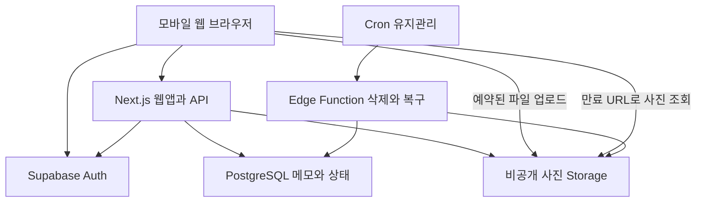
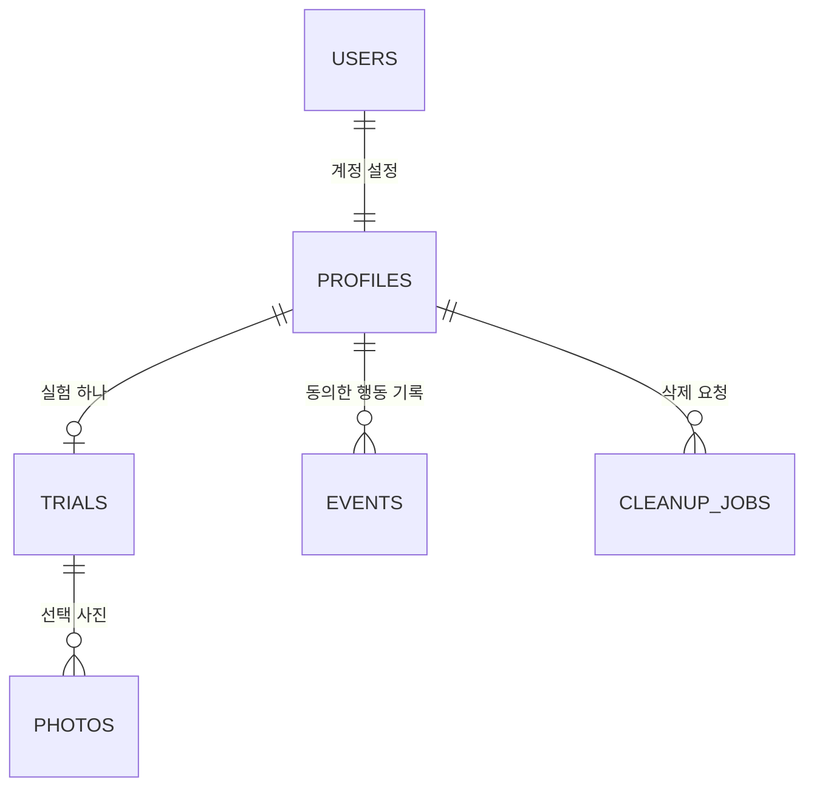
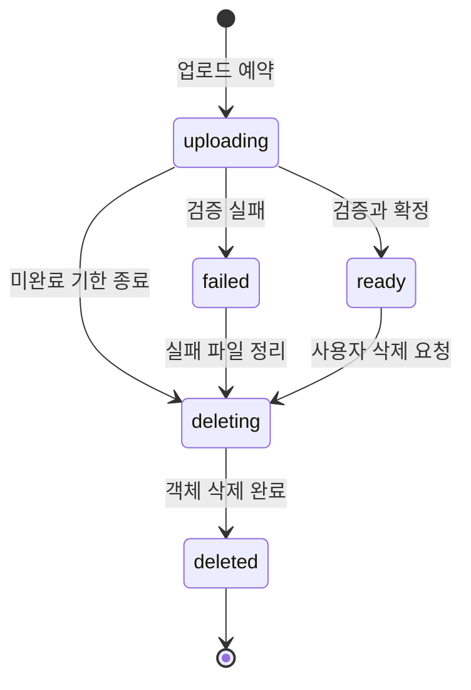

# 기억할 권리 웹앱 아키텍처 설계

이 문서는 `PROJECT.md`의 MVP를 실제 웹앱으로 구현하기 위한 기본 설계다. 사진 파일과 메타데이터를 분리하고, 메모와 보관 상태는 하나의 DB 행에 묶어 저장한다. 실험 기간과 사진 보존 수명을 분리하는 것이 핵심이다.

아래 구성은 구현 기본안이며 배포된 시스템의 현황이 아니다. 특정 호스팅 업체와 요금제는 아직 정하지 않는다. 2026년 10월 8일 초기 화면·API·DB 함수·유지관리 소스를 작성했으며, 실행 환경과 실제 연결 검증 상태는 문서 마지막 절과 `README.md`를 참고한다.

## 1. 구성과 책임



| 구성요소 | 책임 |
| --- | --- |
| 브라우저 | 사용자가 파일 선택, 사진 보기, 메모 작성, 원본·메모 ZIP 생성 |
| Next.js | 화면 렌더링, 검증된 로그인, 요청 검증, 소유권 확인, API 제공 |
| Auth | 이메일 OTP와 세션 발급·갱신 |
| PostgreSQL | 사용자, 실험 시각, 파일 상태, 메모·보관 상태, 제한·삭제 작업 |
| Storage | 원본과 서버가 만든 썸네일을 비공개로 저장 |
| 유지관리 함수 | 사용자가 요청한 삭제 재시도, 24시간 지난 미완료 업로드 정리 |

실험 종료는 `now() >= ends_at`으로 판단한다. 만료를 위해 스케줄러가 제시간에 실행될 필요가 없다. 유지관리 함수는 실험 만료에 따른 정상 사진 삭제를 하지 않는다.

## 2. 기술과 배포 경계

웹앱은 Next.js App Router·TypeScript, DB·Auth·파일은 Supabase를 기본으로 한다. Node.js Route Handlers에서 이미지 디코딩·썸네일 생성을 수행한다. Sharp 등 선택한 이미지 라이브러리와 호스팅의 Node.js 지원을 초기 배포에서 확인한다.

파일은 브라우저에서 Storage로 직접 올려 웹앱 호스팅의 요청 본문 제한을 피한다. 업로드 확정 API는 파일 자체가 아니라 업로드 ID를 받는다. 서버가 Storage의 파일을 읽어 검증한 후 `ready`로 확정한다.

내보내기는 브라우저가 만료 URL로 원본을 받아 ZIP을 만든다. 서버가 대용량 ZIP을 HTTP 응답 본문으로 반환하지 않는다. 첫 MVP는 파일당 10 MiB와 개별 내보내기로 메모리 사용을 제한한다.

SSR 세션은 `@supabase/ssr` 공식 가이드를 따른다. 사용자별 서버 클라이언트는 요청마다 만들며 요청 간 공유하지 않는다. 선택한 Next.js 버전에 맞춰 `proxy.ts` 또는 `middleware.ts`를 사용한다.

호스팅 선정 시 확인할 것은 서버 함수 실행 시간, 이미지 처리 메모리, 10 MiB 파일 읽기·검증 가능 여부, 비밀 환경변수, 로그 접근과 비용이다. 무료 요금제로 모든 보존 약속을 충족한다고 가정하지 않는다.

## 3. 저장소 구조

| 경로 | 역할 |
| --- | --- |
| `AGENTS.md`, `PROJECT.md`, `ARCHITECTURE.md`, `ROADMAP.md` | 개발 지침·제품·설계·작업 기준 |
| `.env.example`, `package.json`, `package-lock.json` | 환경 이름·실행 명령·의존성 고정 |
| `src/app/page.tsx` | 소개 화면 |
| `src/app/login/page.tsx`, `src/app/auth/confirm/route.ts` | 로그인과 Auth 콜백 |
| `src/app/start/page.tsx`, `src/app/revisit/page.tsx` | 시작·다시 보기 |
| `src/app/photos/[id]/page.tsx`, `src/app/memories/page.tsx` | 상세·보관함 |
| `src/app/settings/page.tsx`, `src/app/api/` | 설정·API 진입점 |
| `src/features/upload/`, `revisit/`, `memories/`, `trial/`, `export/` | 사용자 기능별 구현 |
| `src/components/` | 공통 UI |
| `src/lib/supabase/client.ts`, `server.ts` | 브라우저·요청별 서버 클라이언트 |
| `src/lib/server/`, `validation/`, `config.ts` | 서버 전용 작업·입력 검증·정책 설정 |
| `src/types/database.ts` | 스키마에서 생성한 DB 타입 |
| `supabase/migrations/`, `supabase/functions/maintenance/` | DB 변경·정리 작업 |
| `supabase/tests/`, `tests/unit/`, `tests/integration/`, `tests/e2e/` | DB 정책·도메인·연결·화면 검증 |

초기 소스에서 보호 화면은 `src/app/(private)` route group 안에 있다. 외부 경로는 동일하며 공통 layout에서 인증을 확인한다. 최초 migration은 `supabase/migrations/20261008045831_initial_schema.sql`이다. `supabase/schema.sql`은 최초 원본으로 유지하며 후속 변경은 새 migration에 작성한다. `src/types/database.ts`는 실제 적용된 스키마에서 생성하여 클라이언트에 연결한다.

## 4. 데이터 모델의 방침

사진의 보관 상태와 파일 처리 상태를 분리한다. 정상 파일은 `lifecycle = ready`, 보관 사진은 여기에 `preserved_at IS NOT NULL` 조건을 추가한다. 메모와 보관 상태는 `photos` 한 행에 있어 원자적으로 변경할 수 있다.

날짜·GPS·감정 컬럼, 별도 AI 결과 테이블, 팀·공유 권한 모델은 초기 DB에 넣지 않는다. 원본 EXIF를 검색 가능한 DB 데이터로 추출하지 않는다.



`USERS`는 Supabase 관리 `auth.users`이며 직접 스키마를 변경하지 않는다. 다음은 논리 모델이다. 실제 migration에서는 자료형·CHECK·FK·GRANT·RLS를 모두 정의한다.

### 4.1 profiles

| 필드 | 자료형·제약 | 의미 |
| --- | --- | --- |
| `user_id` | UUID PK, `auth.users.id` FK | 사용자 식별자 |
| `timezone` | text, 기본 `Asia/Seoul` | 화면 시각 표시용 |
| `account_state` | `active / deleting` | 계정 삭제 중 새 접근 차단 |
| `analytics_consent` | boolean, 기본 false | 제품 행동 분석 동의 |
| `created_at` | timestamptz | 계정 생성 시각 |

계정 삭제는 파일 정리 완료 후 Auth 계정을 제거하는 순서를 따른다. 파일이 남은 상태에서 DB 연결을 CASCADE로 끊지 않도록 FK 삭제 동작을 설계한다.

### 4.2 trials

| 필드 | 자료형·제약 | 의미 |
| --- | --- | --- |
| `id` | UUID PK | 실험 ID |
| `user_id` | UUID FK, UNIQUE | MVP에서 사용자당 실험 하나 |
| `duration_hours` | integer, 기본 48, 양수 | 시작 시 적용할 기간 |
| `started_at` | timestamptz, nullable | 첫 `ready` 업로드 시 DB 시간으로 설정 |
| `ends_at` | timestamptz, nullable | `started_at + duration_hours` |
| `experiment_version` | text | 실험 정의 버전 |
| `created_at` | timestamptz | 시작 안내 진입·예약 시 생성 |

`started_at`과 `ends_at`은 둘 다 null이거나 둘 다 값이 있어야 한다. 두 값이 있으면 `ends_at > started_at`을 보장한다. 첫 업로드 확정은 실험 행을 잠그고 한 번만 시각을 정한다.

별도 `expired` 컬럼을 유지하지 않는다. `not_started / active / ended`는 DB 현재 시각으로 계산한다. 기존 실험의 시각은 기본 설정이 바뀌어도 바꾸지 않는다.

### 4.3 photos

| 필드 | 자료형·제약 | 의미 |
| --- | --- | --- |
| `id` | UUID PK | 사진 ID, 서버가 생성 |
| `user_id` | UUID FK | 소유자 |
| `trial_id` | UUID FK | 참여 실험 |
| `client_request_id` | UUID, 사용자와 복합 UNIQUE | 업로드 예약 중복 방지 |
| `lifecycle` | enum 또는 CHECK text | `uploading / ready / failed / deleting / deleted` |
| `original_key` | text UNIQUE | 원본 Storage 객체 경로 |
| `thumbnail_key` | text UNIQUE, nullable | 썸네일 객체 경로 |
| `original_name` | text | 사용자가 선택한 파일명, 로그에 기록하지 않음 |
| `mime_type` | text | 서버가 확인한 MIME |
| `byte_size` | bigint | 실제 원본 바이트 수 |
| `width`, `height` | integer | 디코딩 후 실제 크기 |
| `note_text` | text, 기본 빈 문자열 | 현재 메모, 최대 500자 |
| `preserved_at` | timestamptz, nullable | 최초 보관 시각, 메모 비워도 유지 |
| `first_note_at` | timestamptz, nullable | 최초 유효 메모 저장 시각 |
| `first_viewed_at` | timestamptz, nullable | 다시 보기에서 최초 조회, 순서 이어보기용 |
| `version` | integer, 기본 1 | 메모 충돌·상태 변경 확인 |
| `upload_deadline_at` | timestamptz | 예약 후 24시간, 미완료 정리 기준 |
| `validation_token`, `validation_until` | UUID·timestamptz, nullable | 서버 확정 처리의 5분 lease, 이전 작업의 늦은 확정 거절 |
| `ready_at` | timestamptz, nullable | 검증 완료 시각 |
| `delete_requested_at` | timestamptz, nullable | 사용자 삭제 또는 실패 업로드 정리 요청 |
| `deleted_at` | timestamptz, nullable | 실제 파일 정리 완료 시각 |
| `created_at`, `updated_at` | timestamptz | 생성·수정 시각 |

소유권 교차 연결을 막기 위해 `trials`에 `(id, user_id)` UNIQUE를 두고 `photos(trial_id, user_id)`가 이를 참조하는 복합 FK를 둔다. `user_id`, `trial_id`, 객체 경로는 생성 후 일반 수정 대상이 아니다.

`ready` 행은 원본·썸네일과 검증 메타데이터가 모두 있어야 한다. 유효 메모가 최초 저장되면 `first_note_at`과 `preserved_at`을 함께 설정한다. 보관 상태만 있는 행에서 빈 메모는 허용한다. 메모 길이는 프런트와 DB에서 같은 Unicode 코드포인트 기준으로 검증한다.

### 4.4 events

| 필드 | 자료형·제약 | 의미 |
| --- | --- | --- |
| `id` | UUID PK | 이벤트 ID |
| `user_id` | UUID FK | 로그인으로 확인한 사용자 |
| `trial_id`, `photo_id` | UUID, nullable | 본인 소유 대상만 허용 |
| `name` | 허용 목록 text | 행동 종류 |
| `occurred_at` | timestamptz | 서버 수신·도메인 처리 시각 |
| `client_event_id` | UUID, 사용자와 복합 UNIQUE | 클라이언트 재전송 중복 방지 |
| `visit_context` | `organic / prompted / unknown` | 재방문 구분, 불명확하면 unknown |

자유 형식 `payload`는 MVP에서 두지 않는다. 메모, 사진, 파일명, EXIF, 이메일, URL을 이벤트에 넣지 않는다. 동의하지 않은 사용자는 제품 기능을 동일하게 사용할 수 있다. 도메인 시각은 기능에 필요한 최소 데이터로 별도 유지한다.

허용 이벤트는 `trial_started`, `photo_viewed`, `note_saved`, `memory_opened`, `export_generated`로 제한한다. `export_generated`는 브라우저가 ZIP을 만들었다는 뜻이며 사용자의 저장장치에 저장 완료했다는 뜻이 아니다.

중요 저장 이벤트는 가능하면 DB 트랜잭션에서 생성한다. 분석 동의가 없거나 분석 기록이 실패했다는 이유로 사진·메모 저장이 실패해서는 안 된다. 필요하면 저장된 도메인 시각에서 보관 사용자 수를 동의 범위 안에 집계한다.

### 4.5 cleanup_jobs

| 필드 | 자료형·제약 | 의미 |
| --- | --- | --- |
| `id` | UUID PK | 정리 작업 |
| `user_id` | UUID FK, nullable, 계정 정리 시 SET NULL | 진행 중 대상 소유자, 완료 후 연결 제거 |
| `photo_id` | UUID, nullable | 개별 사진 정리 대상 |
| `kind` | `photo_delete / account_delete / incomplete_upload` | 허용 정리 이유 |
| `dedupe_key` | text UNIQUE | 중복 요청 방지 |
| `status` | `pending / running / retry / done / failed` | 작업 상태 |
| `attempts` | integer | 시도 횟수 |
| `run_after`, `locked_until` | timestamptz | 재시도 시각·작업 lease |
| `lease_token` | UUID, nullable | 현재 유지관리 실행만 완료 상태를 갱신하는 권한 |
| `created_at`, `finished_at` | timestamptz | 추적 시각 |
| `error_code` | text, nullable | 개인정보 없는 에러 코드 |
| `progress_token_hash` | text, nullable | 계정 삭제 진행 확인 토큰의 해시 |
| `progress_expires_at` | timestamptz, nullable | 진행 확인 권한의 만료 시각 |

이는 MVP 복구용 DB 작업 목록이며 범용 Queue 서비스를 추가하지 않는다. 계정 삭제는 사용자 차단 후 사진별 정리를 반복하고 마지막에 계정·개인 이벤트를 지운다. 이 테이블의 일반 사용자 직접 조회·변경은 차단한다. 완료 후에는 사용자·사진 연결과 상세 오류를 제거하고 제한된 진행 결과만 토큰 만료 때까지 남긴다.

### 4.6 인덱스

- `photos(user_id, lifecycle, ready_at, id)`: 본인 사진 목록과 다시 보기.
- `photos(user_id, preserved_at DESC, id)`의 보관 행 partial index: 보관함.
- `photos(trial_id, user_id)`: 복합 FK와 실험별 집계.
- `photos(upload_deadline_at)`의 미완료 행 partial index: 실패 업로드 정리.
- `events(user_id, occurred_at)` 및 필요 시 대상 FK 인덱스.
- `cleanup_jobs(status, run_after)`: 실행 대상 조회.

UNIQUE 제약으로 이미 생긴 인덱스는 중복 생성하지 않는다. 실제 쿼리와 RLS 소유권 조건에 맞춰 검증하고 미리 대규모 분석용 인덱스를 늘리지 않는다.

## 5. Storage 경로와 권한

버킷 이름은 `memory-assets`로 제안하며 반드시 private로 생성한다.

```text
{user_id}/{photo_id}/original.{verified_extension}
{user_id}/{photo_id}/thumbnail.webp
```

경로는 서버가 예약 시 생성한다. 원본 파일명은 객체 경로로 사용하지 않는다. 원본이 JPEG·PNG·WebP인지에 맞춰 예약하고 실제 형식이 다르면 거절한다. 기존 파일 덮어쓰기는 기본적으로 비활성화한다.

| 동작 | 주체·권한 |
| --- | --- |
| 업로드 예약·업로드 URL 발급 | 검증된 사용자 요청을 받은 서버 |
| 원본 PUT | 발급받은 예약 URL을 가진 브라우저, 예약 객체 하나만 |
| 썸네일 생성·파일 삭제 | 서버 또는 유지관리 함수의 비밀 키 |
| 정상 사진 SELECT·조회 URL 발급 | 본인 세션, `ready` 행·활성 계정만 |
| DB 직접 변경·직접 삭제 | 일반 브라우저 사용자에게 허용하지 않음 |

Storage SELECT 정책은 경로의 사용자 ID뿐 아니라 해당 `photos`의 소유자, 객체 키, `ready` 상태와 활성 계정까지 확인한다. 업로드 중인 파일과 삭제 요청 파일이 목록·다운로드에 노출되지 않게 한다.

메모 조회는 DB RLS로 본인 행만 허용한다. 인증 사용자에게 테이블 직접 UPDATE 권한을 주지 않아 `ends_at`·소유자·보관 상태 조작을 막는다. 공개 테이블의 SELECT 권한, RLS 정책, 관련 함수 EXECUTE 권한을 명시적으로 설정한다.

서버 변경 함수는 `SECURITY INVOKER`로 만들고 EXECUTE를 PUBLIC·anon·authenticated에서 회수한 뒤 서버 역할에만 허용한다. 서버 역할은 RLS를 우회하므로 함수가 전달받은 검증된 사용자 ID로 소유권을 다시 검사해야 한다. 임의 `user_id`를 요청 본문에서 받지 않는다.

정상 조회용 서명 URL 기본 수명은 300초다. 데이터베이스에는 URL 대신 객체 키만 저장한다. 만료 URL이 필요하면 재발급한다. 이미 발급한 URL은 세션 로그아웃만으로 즉시 무효화된다고 약속하지 않는다. 삭제 요청 후에는 새 URL을 발급하지 않고 실제 객체 삭제와 짧은 TTL로 노출 시간을 제한한다.

## 6. 상태와 기간 규칙



보관은 별도 라이프사이클 전이가 아니다. `ready` 상태 안에서 메모 저장으로 `preserved_at`이 생기며, 기간 만료는 위 상태도에 전이를 만들지 않는다.

| 조건 | 허용 동작 |
| --- | --- |
| 실험 미시작 | 업로드 예약·첫 확정, 아직 기간 없음 |
| 실험 진행 중 | 새 업로드, 사진 조회, 메모, 보관함, 내보내기, 삭제 |
| 실험 종료 | 기존 사진 조회, 메모 추가·수정, 내보내기, 삭제 |
| 계정 deleting | 사용자 데이터 API 차단, 삭제 진행 상태 조회만 허용 |

업로드 예약과 확정 모두 서버·DB 시간을 확인한다. 만료 전에 예약해도 만료 후 확정한 신규 사진은 `ready`로 만들지 않고 정리한다. 첫 정상 확정은 아직 시작하지 않은 실험을 시작한다.

메모 저장은 실험 종료 후에도 허용하되 `first_note_at <= ends_at`인 경우만 실험 내 최초 보관으로 집계한다. 브라우저 시계는 화면 표시용이며 정책 판단에 쓰지 않는다.

## 7. 업로드 처리

1. 브라우저에서 지원 형식과 표시 크기를 먼저 검사한다. `accept`는 사용성 힌트다.
2. `POST /api/uploads`가 계정 상태, 실험 상태, 슬롯·크기를 검증한다.
3. DB 함수가 사용자 실험 행을 잠그고 계정의 비삭제 사진·예약이 20장 이내인지 확인한다. 한 번의 선택은 최대 10장이다.
4. `photos`에 `uploading` 예약을 만들고 고정된 원본 객체 키의 업로드 URL을 발급한다.
5. 브라우저가 원본을 Storage에 업로드한다. 파일별 실패·재시도 상태를 보여 준다.
6. `POST /api/uploads/[id]/complete`가 실제 객체를 읽어 크기·형식·정상 디코딩을 검사한다. 최대 원본 10 MiB, 최대 4천만 픽셀을 기본으로 한다.
7. 서버가 방향을 바로잡은 긴 변 1280px 이하 WebP 썸네일을 만들고 EXIF를 제거한다. 원본 바이트는 변경하지 않는다.
8. DB 트랜잭션에서 계정·기한·사진 상태를 다시 확인하고 `ready`와 메타데이터를 확정한다. 최초 정상 파일이면 실험 시작·종료 시각도 함께 설정한다.
9. 검증 실패나 확정 거절은 정상 사진으로 노출하지 않고 정리 작업을 등록한다.

Storage와 DB는 하나의 분산 트랜잭션이 아니다. 예약 행 → 파일 전송 → 검증 → DB 확정 순서와 보상 정리로 일관성을 맞춘다. 썸네일 생성까지만 성공한 상태도 재확정 또는 정리할 수 있어야 한다.

`client_request_id` 재요청은 기존 예약을 돌려준다. 정상 확정된 ID의 complete 재요청은 같은 사진을 반환한다. 검증 중 중복 호출은 lease 또는 상태 잠금으로 하나의 확정만 허용한다. 자동 정리가 먼저 deleting 상태를 잡았다면 확정은 거절한다.

크기·형식 제한은 클라이언트, 예약 API, 버킷 제한, 확정 검사에서 맞춘다. 미완료 파일은 데이터가 보관된 사진이 아니며 24시간 후 정리할 수 있음을 시작 안내에 적는다. 삭제 중 파일은 삭제 완료 전까지 총 저장 한도 계산에 포함한다.

## 8. 메모와 보관 트랜잭션

`PUT /api/photos/[id]/note` 입력은 `note_text`, `expected_version`, `request_id`다. `request_id`는 분석 중복 구분과 요청 추적용이고 실제 수정 충돌은 버전으로 확인한다.

처리는 하나의 DB 함수 안에서 다음 순서를 따른다.

1. 해당 `user_id`의 활성 계정과 `ready` 사진을 확인하고 행 잠금을 획득한다.
2. 버전이 다르면 409 충돌을 반환한다. 네트워크 재시도로 현재 내용이 이미 요청 내용과 같다면 동일 결과를 반환할 수 있다.
3. 최초 저장에서 빈 메모는 거절한다. 보관된 사진의 기존 메모 비우기는 허용한다.
4. `note_text`를 저장하고 최초 유효 메모라면 `preserved_at`·`first_note_at`을 DB 현재 시각으로 설정한다.
5. 실제 내용 변경 또는 최초 보관에만 버전을 증가시킨다. 최초 시각은 덮어쓰지 않는다.
6. 분석 동의가 있다면 허용 이벤트를 남긴다. 동일 저장의 재시도를 새 보관으로 세지 않는다.
7. 커밋 후 사진·메모·보관 시각·버전을 반환한다.

메모를 보관하고 나서 원본을 다른 버킷으로 이동하지 않는다. 선택 여부는 DB 값으로 표현하여 파일 이동 실패가 보관 실패로 이어지지 않게 한다.

## 9. API 계약

모든 사용자 API는 서버에서 검증된 로그인과 활성 계정을 요구한다. 일반 요청은 `getClaims()` 등 공식 가이드의 검증된 메서드를 사용하고, 계정 삭제처럼 최신 계정 확인이 필요한 작업은 `getUser()`로 다시 확인한다. 예외는 로그인·Auth 콜백과 제한된 삭제 진행 토큰 조회다. JSON 스키마 검증을 공유하고 사용자 ID는 서버가 결정한다.

| 메서드·경로 | 입력·동작 | 정상 응답 |
| --- | --- | --- |
| `GET /api/me` | 계정·실험 조회 | 실험 시각, 서버 시각, 허용 동작 |
| `POST /api/uploads` | 파일명·MIME·크기·client_request_id 목록 | 파일별 예약 ID·객체 path·서명 업로드 token, 201; SDK로 직접 전송 |
| `POST /api/uploads/[id]/complete` | 예약 파일 검증·확정 | 사진 상태·실험 시각, 200 |
| `GET /api/photos` | cursor, limit, `all / preserved` | 본인 정상 사진 목록, 200 |
| `GET /api/photos/[id]` | 상세 조회 | 메모·버전·보관 시각, 200 |
| `POST /api/photos/[id]/view` | 실제 다시 보기 화면에 사진이 나타난 뒤 호출 | 최초 조회 시각 기록, 204 |
| `GET /api/photos/[id]/asset` | `original / thumbnail` | 본인 파일의 만료 URL·expires_at, 200 |
| `PUT /api/photos/[id]/note` | 메모·expected_version·request_id | 저장 결과, 200 |
| `GET /api/photos/[id]/export` | 내보내기 준비 | 원본 만료 URL·파일명·memory.json 데이터, 200 |
| `DELETE /api/photos/[id]` | 명시적 삭제 요청 | 삭제 작업 ID·상태, 202 |
| `POST /api/events` | 허용 이벤트·client_event_id | 동의 여부에 따라 기록 또는 무기록, 204 |
| `PATCH /api/me/preferences` | 분석 동의·타임존 | 현재 설정, 200 |
| `DELETE /api/me` | 본인 계정·데이터 삭제 | 삭제 작업 ID·진행 확인 토큰, 202 |
| `GET /api/deletions/[job_id]` | 본인 세션 또는 작업별 진행 토큰 | 진행 중·실패·완료만, 200 |

목록은 기본 12개, 최대 20개이며 안정적인 `(ready_at, id)` 또는 `(preserved_at, id)` cursor를 쓴다. 다시 보기의 최초 조회 시각은 사용자가 실제로 사진을 본 뒤 POST로 한 번만 기록한다. GET·prefetch만으로 조회 행동을 기록하지 않는다. 분석용 반복 조회는 동의한 이벤트와 별도로 취급한다.

오류 응답은 `{ "error": { "code": "...", "message": "...", "request_id": "..." } }`를 기본으로 한다.

| HTTP·코드 | 의미 |
| --- | --- |
| 400 `INVALID_INPUT` | 메모 길이, 목록 크기 등 입력 오류 |
| 401 `UNAUTHENTICATED` | 유효 로그인 없음 |
| 403 `ACCOUNT_DELETING` | 삭제 진행 중 계정 |
| 404 `NOT_FOUND` | 사진 없음·다른 사용자 사진, 존재 여부를 구분하지 않음 |
| 409 `VERSION_CONFLICT` | 저장된 버전과 다른 메모 수정 |
| 409 `TRIAL_ENDED` | 신규 업로드 기간 종료 |
| 409 `PHOTO_NOT_READY` | 미완료·삭제 중 사진에 저장 시도 |
| 413 `FILE_TOO_LARGE` | 파일 크기·픽셀 수 초과 |
| 415 `UNSUPPORTED_MEDIA` | 미지원·위장·깨진 이미지 |
| 429 `LIMIT_EXCEEDED` | 파일 수·요청 속도 제한 |
| 503 `TEMPORARY_FAILURE` | Storage·DB 일시 오류, 재시도 안내 |

### 요청과 응답 예시

```json
{
  "note_text": "비 오는 날에도 같이 걸어줘서 고마웠다.",
  "expected_version": 1,
  "request_id": "<client-generated-uuid>"
}
```

```json
{
  "photo_id": "<photo-uuid>",
  "note_text": "비 오는 날에도 같이 걸어줘서 고마웠다.",
  "preserved_at": "2026-10-08T01:00:00Z",
  "first_note_at": "2026-10-08T01:00:00Z",
  "version": 2
}
```

예시의 식별자는 설명용 자리표시자이며 그대로 실행할 값이 아니다.

## 10. 내보내기와 삭제

### 10.1 개별 내보내기

서버는 본인 소유 정상 파일과 메모를 읽어 원본 URL과 JSON을 반환한다. 브라우저는 원본을 가져오고 JSZip 등 고정 버전 라이브러리로 아래 ZIP을 만든다.

| ZIP 내부 파일 | 내용 |
| --- | --- |
| `original.jpg` 또는 실제 형식의 확장자 | 사용자가 올린 원본 바이트 |
| `memory.json` | 메모와 최소 메타데이터 |

ZIP 이름은 `memory-{photo_id}.zip`으로 제안한다.

`original`의 확장자는 실제 형식에 따른다. 안전한 파일명을 쓰고 원래 파일명은 JSON 필드로 보존한다. JSON은 UTF-8이며 최소 필드는 `schema_version: 1`, `photo_id`, `original_name`, `note_text`, `uploaded_at`, `preserved_at`, `exported_at`이다. 미보관 사진의 `preserved_at`은 null이다.

ZIP을 만들기 전에 이미지 읽기와 JSON 생성이 모두 성공해야 한다. 만료·네트워크 실패를 표시하고 URL을 재발급할 수 있다. 다운로드 버튼을 눌렀다는 이유로 실제 보존 성공을 기록하지 않는다. QA는 ZIP을 직접 열고 원본 해시와 한글 메모를 비교한다.

### 10.2 개별 삭제

1. UI가 사진과 메모가 함께 삭제된다는 사실과 내보내기를 안내한다.
2. 사용자 확인 후 서버가 트랜잭션으로 `deleting` 표시와 정리 작업을 만든다.
3. 새 조회 URL·메모 저장을 차단하고 목록에서 숨긴다.
4. 유지관리 함수가 원본·썸네일을 Storage API로 삭제한다. 이미 없는 객체는 성공으로 취급한다.
5. 성공 후 민감한 메모·파일명 등을 비우고 `deleted`로 확정한다.

삭제 완료 전에는 “삭제 중”으로 표시한다. DB 행을 먼저 물리 삭제해 파일 위치를 잃지 않는다. 동일 삭제 요청은 같은 작업을 반환한다.

### 10.3 계정 삭제와 유지관리

계정 삭제는 `profiles.account_state = deleting`을 먼저 적용한다. 새 사용자 데이터 접근을 차단하고 세션을 종료하는 절차를 진행한다. 재시도를 담당하는 작업은 로그아웃과 무관하게 계속 처리한다.

모든 본인 파일이 삭제된 뒤 메모·사진·실험·개인 이벤트·profile과 Auth 계정을 제거한다. 파일 정리 전에는 참조 행을 먼저 제거하지 않는다. 진행 확인에는 32바이트 난수 토큰을 발급하고 서버에는 SHA-256 해시만 저장한다. 브라우저는 토큰을 현재 탭의 sessionStorage에 최대 24시간 보관하고 Authorization 헤더로 해당 작업 조회에만 사용한다. 계정이 삭제되어도 진행 중·실패·완료 상태만 확인할 수 있으며 사용자·파일·메모 정보는 반환하지 않는다. 토큰 만료는 조회 권한만 끝내며 진행 중 정리 작업을 없애지 않는다. 완료된 작업의 최소 결과는 토큰 만료 후 정리한다.

Cron은 10분마다 유지관리 함수를 호출하는 기본안이다. 호출 비밀은 서버/Vault에 저장한다. 재시도는 1분·5분·30분·2시간 이후로 지연시키고 계속 실패하면 운영 확인 대상으로 남긴다. 작업 lease 만료 시 다른 실행이 이어 처리한다.

미완료 정리는 `uploading / failed`, 마감 시각 경과, 보관 시각 없음이라는 조건을 DB에서 확인한 뒤 대상을 확보한다. `ready` 파일은 실험 기간·미선택 여부와 관계없이 정리 대상이 아니다.

## 11. 설정과 관측

| 설정 | 기본값·용도 |
| --- | --- |
| `NEXT_PUBLIC_SUPABASE_URL` | 프로젝트 URL |
| `SUPABASE_PROJECT_ID` | 전용 개발 프로젝트 ID, DB 타입 생성 대상 |
| `NEXT_PUBLIC_SUPABASE_PUBLISHABLE_KEY` | 브라우저 공개용 키 |
| `SUPABASE_SERVER_SECRET_KEY` | 서버 변경 전용 비밀 키, 배포 환경에서 SDK 호환 키 사용 |
| `APP_BASE_URL` | Auth 콜백의 허용 주소 |
| `TRIAL_DURATION_HOURS` | 48, 새 실험 생성 시 DB에 복사 |
| `MAX_PHOTOS_PER_USER` | 20, 기존·보관·미선택·예약 합계 한도 |
| `MAX_FILES_PER_BATCH` | 10 |
| `MAX_IMAGE_BYTES` | 10485760, 10 MiB |
| `MAX_IMAGE_PIXELS` | 40000000 |
| `ASSET_URL_TTL_SECONDS` | 300 |
| `UPLOAD_RESERVATION_TTL_HOURS` | 24 |
| `MAINTENANCE_CALL_SECRET` | 내부 함수 호출 인증, 브라우저 노출 금지 |

위 제한 설정의 이름은 논리적 설정 이름이다. 이번 초기 구현은 런타임 환경변수로 제한을 조절하지 않고 `src/lib/config.ts`와 서버 전용 `public.app_policy()`에 기본값을 고정한다. `.env.example`에는 개발 프로젝트 ID·URL·키·APP_BASE_URL·유지관리 비밀·전용 개발 통합 검증 연결 이름만 둔다. 통합 테스트는 `INTEGRATION_SUPABASE_PROJECT_ID`와 HTTPS URL이 정확히 일치하는 개발 프로젝트만 대상으로 하며 운영 데이터를 사용하지 않는다. 통합 검증에서 두 정책이 같은지 확인하며 값 변경 시 새 migration과 TypeScript 설정을 함께 수정한다. 제한값을 요청 본문으로 받아 DB에 전달하지 않는다. Auth 콜백은 허용 주소로만 이동한다.

운영 로그에는 request ID, API 종류, 처리 시간, 오류 코드, 작업 상태만 남긴다. 메모·파일명·서명 URL·OTP·토큰은 제외한다. 분석 이벤트는 동의 설정과 연동하며 개인 사진을 운영자가 열어 보는 관리 화면은 MVP에 만들지 않는다.

MVP 출시 전에 파일 저장량·전송량·삭제 작업 실패 수를 확인할 수 있게 한다. 계정당 원본은 최대 약 200 MiB이며 썸네일·전송량·유예 중 파일은 추가 비용이다. 비용 때문에 정상 보관 사진을 몰래 삭제하지 않는다.

DB 백업과 객체 파일 백업은 별개다. 보관 약속을 운영하는 동안의 복구 계획, 실제 파일 복원 여부, 서비스 종료 시 반출 방침을 점검한다. 공급자의 DB 백업이 사진 파일도 복원해 준다고 가정하지 않는다.

## 12. 주요 실패와 검증

| 실패 | 처리·검증 |
| --- | --- |
| 업로드 중 연결 종료 | 같은 예약 재시도 또는 24시간 후 미완료 정리 |
| 파일 완료 후 DB 확정 실패 | complete 재시도, 검증 전 정상 목록에 미노출 |
| Storage 성공·썸네일 실패 | 재생성 후 확정, 실패 사진 자동 보관 없음 |
| 메모 저장 응답 유실 | 현재 내용·버전 재조회, 동일 저장 중복 보관 방지 |
| 두 기기 동시 수정 | 409, 두 내용을 보여 주고 사용자가 선택 |
| 만료 직전 업로드 | 확정 시 DB 시간으로 재확인 |
| 기간 이후 메모 | 저장 허용, 실험 이후 행동으로 분리 |
| URL 만료 | 새 접근 권한 확인 후 재발급 |
| 사용자 A의 ID를 B가 요청 | 404 또는 권한 차단, DB·Storage에서도 거절 |
| 삭제 작업 실패 | 조회 차단 유지, 재시도·운영 확인 |
| 브라우저 재접속 | DB 상태에서 복원, 보관 상태가 브라우저 저장소에 의존하지 않음 |

개발 검증은 단위 테스트, 격리된 Auth·DB·Storage 통합 테스트, 모바일 E2E로 나눈다. 특히 서버 비밀 키가 있는 API의 소유권 검사와 브라우저의 직접 변경 우회 시도를 실제 연결에서 검사한다.

## 13. 공식 기술 참고

2026년 10월 8일 설계 시 확인한 공식 자료다. 아래 기술 동작을 참고한 설계이며 제품 효과를 입증하는 자료는 아니다. 구현 시 다시 버전·권한·가격을 확인한다.

- [Next.js Route Handlers](https://nextjs.org/docs/app/getting-started/route-handlers): 화면과 API를 한 웹앱에서 구성.
- [Supabase SSR 클라이언트](https://supabase.com/docs/guides/auth/server-side/creating-a-client?queryGroups=framework&framework=nextjs): 쿠키 세션·클라이언트 분리·검증·캐시 주의.
- [Supabase Storage 버킷](https://supabase.com/docs/guides/storage/buckets/fundamentals): 비공개 버킷과 제한된 접근.
- [Storage 접근 제어](https://supabase.com/docs/guides/storage/security/access-control): Storage RLS.
- [Storage 파일 제공](https://supabase.com/docs/guides/storage/serving/downloads): 인증 다운로드·만료 URL.
- [Supabase Row Level Security](https://supabase.com/docs/guides/database/postgres/row-level-security): 소유권 정책과 인덱스.
- [Supabase 새 테이블 API 노출 변경](https://supabase.com/changelog/45329-breaking-change-tables-not-exposed-to-data-and-graphql-api-automatically): 새 테이블의 명시적 GRANT 확인.
- [Supabase Changelog](https://supabase.com/changelog): 구현 시 관련 변경 점검.
- [MDN 파일 입력](https://developer.mozilla.org/en-US/docs/Web/HTML/Reference/Elements/input/file): 사용자가 선택한 파일 접근과 형식 힌트.

## 14. 구현 전 남은 선택

실제 호스팅, 실행 버전, OTP 발송 설정, 비밀 키 형식, 운영 종료 고지·반출 유예 기간을 정한다. 이 선택이 핵심 사용자 흐름을 막지 않도록 로컬 데모와 도메인 구현은 먼저 진행한다. 실제 사용자 사진을 받기 전에는 보존·권한·반출 검증을 완료한다.

## 15. 초기 구현 상태

Next.js 16.4.0, React 19.3.0, Supabase JS 2.117.3, SSR 0.12.7, CLI 2.120.0의 버전을 공식 자료에서 확인하고 `package.json`에 고정했다. CSS는 별도 UI 라이브러리 없이 모바일 우선으로 작성했다. 메모 편집기는 다시 보기와 상세에서 공유한다. 서버는 `getUser()`로 검증하며 일반 사진 조회·서명 URL 발급은 사용자 세션과 RLS를 사용한다.

5개 테이블·제약·인덱스·최소 GRANT·RLS·비공개 버킷·서버 전용 SECURITY INVOKER 함수의 원본 SQL을 작성했다. profile → trial → photo 순서로 잠그며 메모 수정과 삭제를 직렬화한다. 검증 실패·만료 경계의 업로드 정리는 DB 결과로 커밋하여 예외 롤백 때문에 정리 요청이 사라지지 않게 했다. 네트워크 오류는 업로드 lease를 반환하고 재시도를 허용한다.

삭제 요청은 즉시 새 조회와 저장을 차단하지만 이미 발급된 업로드 토큰이 파일을 재생성하지 않도록 객체 제거를 약 2시간까지 지연할 수 있다. 계정 삭제는 사진 작업을 기다리고 DB 정리·Auth 제거까지 성공한 뒤 완료한다. 진행 확인 토큰은 탭 sessionStorage에 24시간까지 두며 서버에는 해시만 저장한다. 유지관리 Edge Function은 개발 프로젝트에 배포했지만 내부 호출 비밀과 Cron은 구성하지 않아 자동 작업은 비활성 상태다. 함수는 런타임 제공 `SUPABASE_SECRET_KEYS`를 사용한다.

후속 작업에서 npm 접속과 Docker 접근이 복구됐다. `package-lock.json` 생성과 `npm ci`, lint·전체 typecheck·단위 테스트 8개·Next.js 운영 빌드가 통과했다. 이후 모바일 소개와 합성 사진 업로드·보관/ZIP E2E 2개까지 통과했다. Sharp 0.35.5·Vitest 4.1.11로 보안 패치를 반영했으며 운영 의존성 audit은 0건이다. 개발용 lint 간접 의존성의 미패치 경고 5건은 남아 있다.

로컬 최초 migration 적용을 확인한 뒤, 사용자의 지시에 따라 로컬 DB를 중지하고 원격 Supabase 전용 개발 프로젝트로 전환했다. `JooJeongwon` 조직·서울 지역의 `recall-memory` (`mgedpimvznbatmipaacn`)에 최초 migration을 적용하고 실제 원격 타입을 생성했다. 로컬 migration 파일 버전도 원격 이력 `20261008045831`과 맞췄다. DB RLS·GRANT·서버 함수 EXECUTE와 비공개 버킷을 확인했으며 보안 advisor의 경고·오류는 없었다.

`.env.local`에는 개발 프로젝트 ID·URL·공개 키·서버 키를 설정했다. 원격 통합 테스트에서 두 사용자 Auth 세션, RLS 행 분리, 직접 테이블 쓰기 및 서버 전용 함수 차단, 업로드 재요청 중복 방지와 20장 한도, 첫 사진 확정 시 실험 시각 설정, 메모 첫 공백 거절·500자 저장·501자 거절, 실험 내·외 최초 메모 시각 구분이 통과했다. 모바일 E2E에서 분석 동의 저장, 철회 시 기존 이벤트 삭제와 이후 이벤트 미기록, 보관 사진 삭제 요청·숨김, 계정 삭제 진행 토큰과 대기 UI를 확인했다. 별도 원격 합성 사진 통합 테스트에서 삭제 큐 중복 방지, 작업 claim, Storage API로 원본·썸네일 제거, 완료 RPC의 사진 개인정보 정리와 작업 완료를 확인했다. 실패 결과의 재시도 상태·이전 lease 거절·새 lease 재claim도 검증했다. 유지관리 함수는 개발 프로젝트에 배포했으며 인증 없는 요청이 401로 거절됨을 확인했다. 내부 호출 비밀과 Cron을 구성하지 않아 자동 삭제와 계정 전체 DB/Auth 제거는 검증하지 않았다. 빈 목록 복구·HEIC/10 MiB 초과 사전 거절·Storage 전송 실패 후 재시도·두 사진 탐색도 확인했다. MIME 위장 JPEG·손상 PNG·40,008,000픽셀 PNG의 서버 확정 거절·목록 제외도 검증했다. 이미지 검증 단위 테스트도 10 MiB 바이트 한도를 확인했다. 방향 6인 합성 JPEG로 방향 보정 WebP 썸네일과 EXIF 제거를 검증했다. 동시 수정 E2E에서는 최신 메모 표시와 사용자 초안 보존·재저장을 확인했고, 일시 저장 실패 뒤 입력·기존 DB 내용을 유지해 재시도하는 흐름도 통과했다. DB 시간 fixture 만료 테스트에서 신규 예약·만료 후 확정 거절, 기존 ready 사진의 메모 수정·원본 접근을 확인했고, 브라우저 E2E로 만료 후 ZIP 반출까지 확인했다. 서버 키가 브라우저 정적 번들에 포함되지 않는 것도 운영 빌드 결과에서 확인했다.

Supabase 연결 도구는 Auth URL·메일 템플릿을 변경하지 못한다. 참여자 로그인을 시험하기 전 [Auth URL 설정](https://supabase.com/dashboard/project/mgedpimvznbatmipaacn/auth/url-configuration)에서 Site URL `http://localhost:3000`과 `localhost`·`127.0.0.1`의 `/auth/confirm` redirect URL을 지정해야 한다. 현재 조직은 Free 플랜이며, 2026-06-03 이후 생성된 Free 프로젝트는 기본 SMTP에서 메일 템플릿을 수정할 수 없다. 숫자 OTP를 메일 기본 흐름으로 쓰려면 자체 SMTP 설정이 필요하다 ([Supabase 변경 안내](https://supabase.com/changelog/46599-changes-to-email-template-customisation-on-free-tier)). 브라우저 E2E는 합성 세션으로 사진 보존·ZIP 반출과 무효화된 서명 URL 실패 후 재시도까지 통과했다. 실제 Auth 메일, 48시간 뒤 로그아웃·재로그인은 아직 검증하지 않았다. API의 JSON 결과는 Zod 계약으로 검증한다. 전체 사용자 흐름이나 MVP 완료를 의미하지 않는다.
